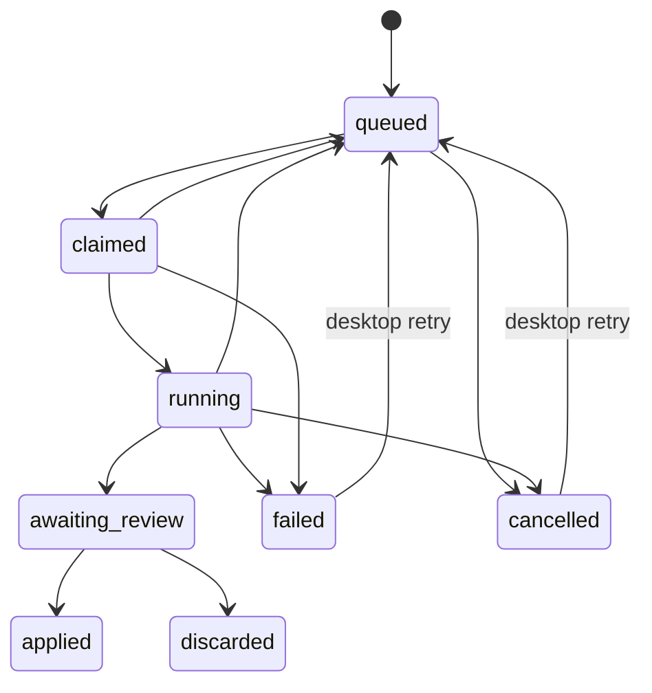
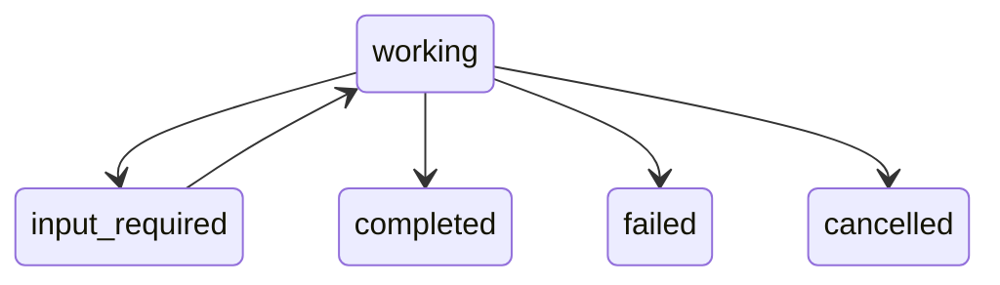

# Durable records
| Record | Identity and constraints | Lifetime |
| --- | --- | --- |
| Library generation | Unique epoch for current restored or switched library | Survives ordinary restart. Rotate after replacing the collection. |
| Delegated work | Opaque UUID, unique unresolved album/kind/digest, immutable input, base revision, group ID | Outlives clients and Tasks. |
| Attempt | Work plus generation, principal, token verifier, absolute expiry, progress sequence | Terminal attempt reason remains in history. |
| Result | Work and input digest, validated recommendation, evidence, validation state and result digest | Exact result bound to review and disposition. |
| Replay | Principal, operation, key and canonical input digest | An identical retry yields the first committed outcome. |
| Legacy linkage | Unique historical job and child kind, common group ID | Preserve original row and decision timestamps. |
| Audit and outbox | Work or operation reference, epoch, sequence and transition | Insert atomically alongside the owning row. |
| Operation | Opaque ID, owner, epoch, command, progress, checkpoint, partial effects and terminal output | Recoverable after connection loss and restart. |
| MCP Task | Opaque ID, owning operation and principal, profile, timestamps and input request keys | Active until terminal; clean up after retention without deleting the operation. |

An attempt may complete from claimed before a progress update. Expiry releases the lease or fails exhausted attempts. A review decision checks current context and the exact result again.

Cancel requests record intent. Terminal outcomes describe what the app actually finished.
